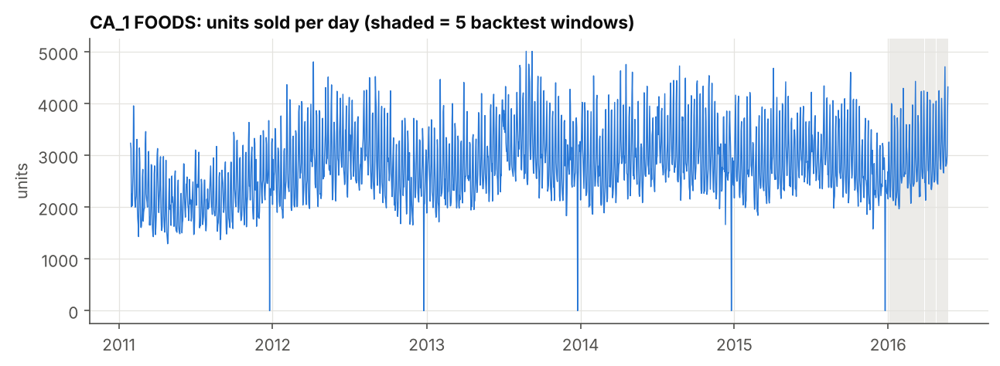
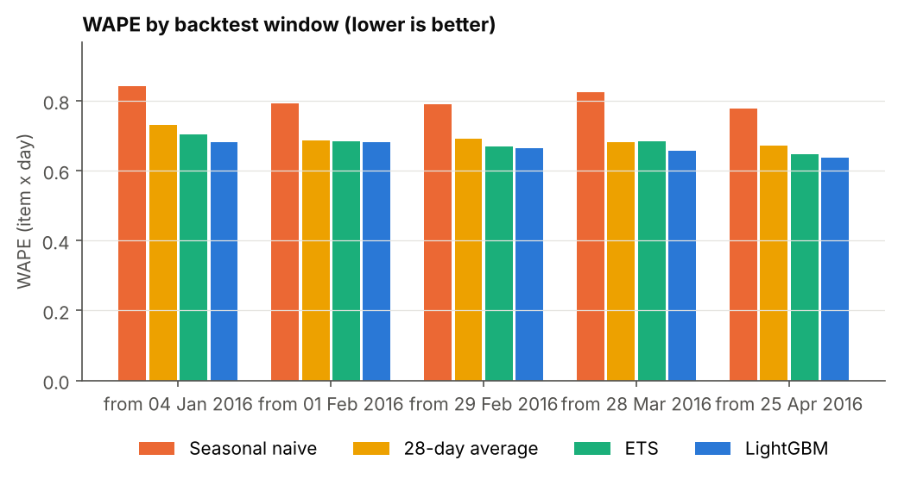
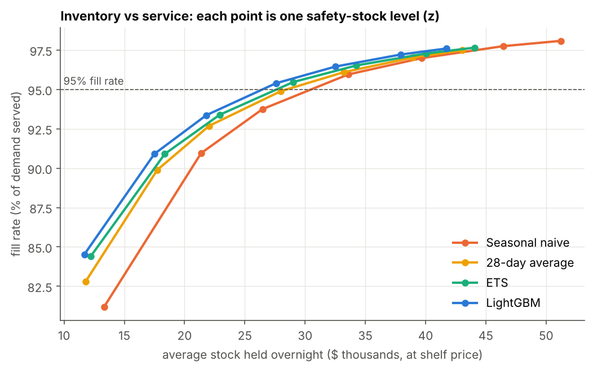

# Retail demand forecasting and replenishment on M5 (Walmart) data

Forecast daily demand for ~1,400 grocery items in one store, measure accuracy honestly with
rolling backtests, then turn the forecasts into a **reorder rule** and test what better
forecasts are worth in stock held and sales lost.

The setting is the one Indian quick commerce (Blinkit, Zepto, Swiggy Instamart) and
e-commerce grocery players face every day: a small dark store with a few thousand SKUs,
replenished daily from a mother hub, where an out-of-stock item is a lost order because the
customer simply opens another app.



## Results at a glance

**Scope:** Walmart store `CA_1`, category `FOODS` (FOODS_1/2/3), 1,406 items with at least a
year of history. Data: [M5 Forecasting - Accuracy](https://www.kaggle.com/competitions/m5-forecasting-accuracy), 2011-01-29 to 2016-05-22.

**Backtest:** 5 rolling origins, each forecasting the next 28 days (Feb to May 2016).

| Model | WAPE (item-day) | WAPE (item-week) | Bias |
|---|---:|---:|---:|
| Seasonal naive (same weekday last week) | 80.4% | 40.8% | -5.7% |
| 28-day moving average | 69.1% | 37.2% | -5.1% |
| ETS (AutoETS, weekly season) | 67.7% | 38.9% | -4.7% |
| **LightGBM** (lags, rolling stats, prices, calendar) | **66.3%** | **36.7%** | -6.8% |

LightGBM beats every baseline in every fold (see below) and in every department. Its edge
over ETS is small overall (1.4 points) but grows with volume: 40.0% vs 42.9% WAPE on the
top 5% of items, which carry most of the units. On the slowest half of items nothing does
well (all models are above 110% WAPE), which is a signal to manage those with simple
rules rather than more modelling.



**Inventory:** with a daily order-up-to policy (2-day lead time, lost sales), the stock
needed to serve 95% of demand on the held-out last window was:

| Forecast driving the policy | Stock value needed for 95% fill rate | vs seasonal naive |
|---|---:|---:|
| Seasonal naive | $30,506 | |
| 28-day average | $28,466 | -7% |
| ETS | $27,641 | -9% |
| **LightGBM** | **$26,468** | **-13%** |

Same service, 13% less stock than the naive rule and 4% less than ETS. In a dark store
that is shelf space and working capital freed for more SKUs.



## Method

### 1. Data (`src/data.py`)
Sales are melted to one row per item per day and joined to the calendar (events, SNAP
food-stamp days) and weekly shelf prices. Days before an item's first price are dropped,
since the item was not yet on the shelf. About 47% of item-days have zero sales, so demand
is intermittent: the reason for WAPE instead of MAPE.

### 2. Baselines (`src/backtest.py`)
Fitted per item with [statsforecast](https://github.com/Nixtla/statsforecast):
seasonal naive (period 7), a 28-day moving average, and AutoETS with a weekly season.
Negative forecasts are clipped to zero.

### 3. LightGBM (`src/features.py`, `src/backtest.py`)
One global model across all items, Tweedie objective (suits zero-heavy count data).

- **Direct multi-horizon:** one model per forecast week. The week-1 model may use sales up to
  7 days old, the week-4 model only sales 28+ days old. No model feeds its own predictions
  back in, so errors do not compound and there is no leakage.
- **Lag features:** six same-weekday lags, same day last year.
- **Rolling features:** means over 7/14/28/56/112 days, 28-day std, share of zero days, trend ratio.
- **Price features:** discount vs highest and average price so far, week-on-week price change,
  price vs 28-day average, price vs department average, number of past price changes.
- **Calendar:** weekday, day of month, week of year, events, SNAP days, item age.

Rolling means dominate the gain, followed by item identity; prices and events add smaller
lifts (`reports/figures/04_feature_importance.png`).

### 4. Evaluation (`src/metrics.py`)
- **WAPE** = sum |actual - forecast| / sum actual, at item-day and item-week grain.
- **Bias** = sum (forecast - actual) / sum actual. All models under-forecast slightly; the
  safety stock absorbs it because it is sized on each model's own errors.
- Rolling origins: cutoffs d_1801, 1829, 1857, 1885, 1913, horizon 28 days each.

### 5. From forecast to reorder rule (`src/inventory.py`)
Periodic review, order-up-to policy for a dark store replenished from a mother hub:

```
review period R = 1 day, lead time L = 2 days, protection period P = L + R = 3 days
order-up-to level  S  = forecast demand over the next P days + safety stock
safety stock       SS = z × σ_P
reorder point      ROP = forecast demand over L days + SS
order today        q  = max(0, ceil(S − on hand − in transit))
```

`σ_P` is each item's standard deviation of the **3-day summed forecast error**, measured out of
sample on backtest folds 1 to 4. This is where accuracy turns into money: a better forecast
has a smaller σ_P, so it needs less safety stock for the same service level.

The policy is simulated day by day on fold 5 (never seen when sizing σ), with real M5
demand and lost sales. `z` is swept from 0 to 2.33 to trace each model's
stock-vs-service curve. An **ABC policy** is also tested: A items (top 80% of revenue)
target 98% cycle service, B 95%, C 90%. `data/outputs/reorder_policy.csv` holds the
resulting per-item safety stock, reorder point and order-up-to level.

| Model (ABC policy) | Fill rate | Stock-out item-days | Avg stock value | Days of cover |
|---|---:|---:|---:|---:|
| Seasonal naive | 97.0% | 2.1% | $43,723 | 4.75 |
| ETS | 96.6% | 2.4% | $37,748 | 4.14 |
| LightGBM | 96.5% | 2.3% | $35,708 | 3.88 |

## Why this matters for Indian e-commerce and quick commerce

- **Lost sales, not backorders.** A quick-commerce customer who sees "out of stock" orders
  elsewhere. The simulation counts unmet demand as lost, which matches that.
- **Tiny stores, daily replenishment.** Dark stores hold days, not weeks, of stock. The
  policy here (daily review, 2-day lead time, about 4 days of cover) is that shape.
  Moving from a naive rule to a model-driven one frees about 13% of stock value at the
  same service level: room for more SKUs in the same space.
- **Intermittent long tail.** Half the items sell under about one unit a day. For them the
  win is in the policy (service-level tiers, minimum display quantities), not in a better
  model. ABC tiers put the safety stock where the revenue is.
- **Price and event effects.** Discounts, festival spikes (Diwali, Holi, payday weekends)
  and app-wide sales play the role that SNAP days and US holidays play in M5. The same
  price and calendar features carry over directly.
- **The metric the business uses.** WAPE weights errors by volume, so it lines up with
  revenue and stock rather than being dominated by slow items.

## Limitations and next steps

- Censored demand: M5 records sales, not demand, so stock-outs in the history look like
  low demand. A real system would flag stock-out days and correct for them.
- Forecasts in the simulation come from one origin per 28 days; production would
  re-forecast daily, which would favour the model with fresh lags even more.
- No case-pack rounding, shelf-capacity limits, shelf life or hub capacity. Perishables
  (dairy, produce) need a waste term in the policy.
- Quantile forecasts (LightGBM quantile loss or conformal intervals) could replace the
  normal-approximation safety stock, especially for slow movers.
- Hyperparameters were not tuned; a small Optuna search on the first folds is a cheap win.
- Scaling to all 10 stores, or adding cross-store features, is a straightforward extension.

## Reproduce

```bash
pip install -r requirements.txt
./scripts/download_data.sh          # Kaggle CLI if configured, else a public mirror
python -m src.data                  # build the item-day panel (~1 min)
python -m src.backtest              # baselines + LightGBM, 5 folds (~20 min on 4 cores)
python -m src.inventory             # reorder policy + simulation (seconds)
python -m src.report                # charts and tables into reports/
jupyter notebook notebooks/m5_walkthrough.ipynb
```

## Repo layout

```
src/
  data.py        load M5, filter store/category, build the long panel
  features.py    lag, rolling, price and calendar features
  backtest.py    rolling-origin backtest: baselines + LightGBM
  metrics.py     WAPE, bias, weekly aggregation
  inventory.py   safety stock, reorder point, order-up-to simulation
  report.py      figures and markdown tables
notebooks/m5_walkthrough.ipynb   results walkthrough (reads saved outputs)
reports/figures/                 charts used in this README
reports/results.md               all result tables
data/outputs/                    small CSV outputs (simulation, policy, feature importance)
```
